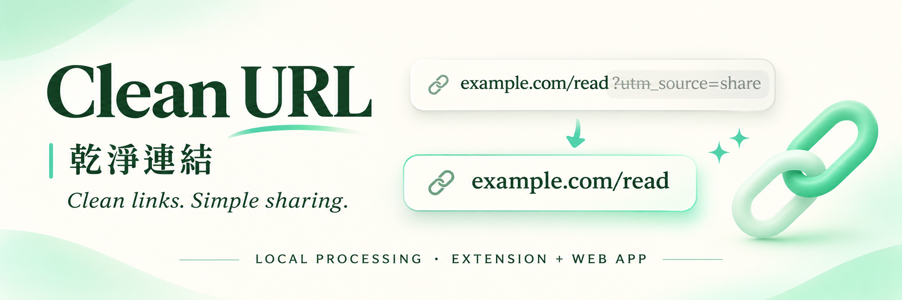

# Clean URL｜乾淨連結

[繁體中文](README.md) | **English**

[](https://chromewebstore.google.com/detail/clean-url%EF%BD%9C%E4%B9%BE%E6%B7%A8%E9%80%A3%E7%B5%90/ecfnblelamnokaknaepkjbhbckmakkka)
[](https://github.com/bruce-yang-422/clean-url-extension/releases)
[](https://cleanlink.stack-base.com/)


[](LICENSE)

Remove tracking parameters from URLs and copy a clean, short link — entirely on your device. Available as a Chrome/Edge extension and an offline-capable web app (PWA), both sharing the same cleaning rules.

**[Install extension](https://chromewebstore.google.com/detail/clean-url%EF%BD%9C%E4%B9%BE%E6%B7%A8%E9%80%A3%E7%B5%90/ecfnblelamnokaknaepkjbhbckmakkka)** ·
**[Web app](https://cleanlink.stack-base.com/)** ·
**[Download](https://github.com/bruce-yang-422/clean-url-extension/releases)** ·
**[Privacy policy](https://cleanlink.stack-base.com/privacy.html)**

```text
https://shopee.tw/product-name-i.123.456?sp_atk=…&utm_source=line   →   https://shopee.tw/product/123/456
https://youtu.be/abcdefghijk?si=AbCdEf&t=42                          →   https://youtu.be/abcdefghijk?t=42
https://example.com/article?utm_source=x#intro:~:text=hello          →   https://example.com/article#intro
```

## Contents

- [Features](#features)
- [Installation](#installation)
- [Usage](#usage)
- [Cleaning rules](#cleaning-rules)
- [Permissions & privacy](#permissions--privacy)
- [Development](#development)
- [Project structure](#project-structure)
- [License](#license)

## Features

- **General tracking cleanup**: removes UTM tags, ad click IDs, newsletter and marketing-automation parameters, and `#:~:text=` text-highlight fragments.
- **Site-specific rules**: tidies links from popular Taiwanese shopping sites and major social platforms, e.g. shortening Shopee, Coupang and Amazon product URLs to the product itself.
- **Never breaks links**: keeps search filters, product IDs, unknown parameters and anchors; signed cloud-storage URLs are left untouched.
- **Context menu**: right-click a page or any link to copy its clean URL without opening the popup.
- **Editable result**: tweak the clean link in the popup before copying.
- **7 UI languages**: Traditional Chinese, Simplified Chinese, English, Japanese, Korean, Spanish and French, following the browser language.
- **Web app / PWA**: installable and works offline; on Android it can receive URLs from other apps' share menus.
- **Fully local**: no server, no data collection, no browsing history, no third-party dependencies.

## Installation

### Chrome Web Store (recommended)

1. Open the [Chrome Web Store listing](https://chromewebstore.google.com/detail/clean-url%EF%BD%9C%E4%B9%BE%E6%B7%A8%E9%80%A3%E7%B5%90/ecfnblelamnokaknaepkjbhbckmakkka) and click **Add to Chrome**.
2. Edge users can open the same page and allow extensions from other stores when prompted.

### Manual install

1. Download `clean-url-extension-v<version>.zip` from [Releases](https://github.com/bruce-yang-422/clean-url-extension/releases) and unzip it.
2. Open `chrome://extensions` (or `edge://extensions`) and turn on **Developer mode**.
3. Click **Load unpacked** and select the unzipped folder (the one containing `manifest.json`).

### Web app

Open [cleanlink.stack-base.com](https://cleanlink.stack-base.com/) to use it right away, or install it via **Install app** / **Add to Home Screen**. After the first online visit it works offline.

## Usage

| Method | How |
| --- | --- |
| Toolbar popup | Click the Clean URL icon, review or edit the clean link, then click **Copy clean link**. |
| Context menu (page) | Right-click a page → **Copy clean link of this page**. The icon briefly shows ✓. |
| Context menu (link) | Right-click any link → **Copy clean link address**, without opening it. |
| Web app | Paste a URL and click **Copy clean link**. |
| Share menu (Android) | After installing the PWA, choose Clean URL from another app's share menu. |

The UI follows Chrome's display language (`chrome://settings/languages`); restart Chrome after changing it. Share-target is not supported by PWAs on iPhone/iPad — paste the URL instead.

## Cleaning rules

### General rules

Applied to every site. Parameter names are case-insensitive; the list is informed by the [AdGuard URL Tracking filter](https://github.com/AdguardTeam/AdguardFilters/tree/master/TrackParamFilter).

| Category | Parameters |
| --- | --- |
| UTM | `utm_*` |
| Ad click IDs | `gclid` `gbraid` `wbraid` `dclid` `gclsrc` `gad_source` `gad_campaignid` `fbclid` `msclkid` `ttclid` `twclid` `igshid` `yclid` `ysclid` `li_fat_id` `epik` `irclickid` and more |
| LINE user ID | `luid` (when the value is a LINE user ID) `line_uid` |
| Analytics | `_ga` `_gl` `mtm_*` `pk_*` `piwik_*` `s_cid` `xtor` `at_*` `wt_mc` |
| Email & marketing automation | `mc_cid` `mc_eid` `mc_tc` `mkt_tok` `_hsenc` `_hsmi` `__hs*` `hsa_*` `elq*` `_kx` `vero_*` `oly_*` `ml_subscriber*` `bsft_*` |
| Affiliate & app attribution | `cjevent` `sscid` `tduid` `_branch_*` `adjust_*` `adj_*` |
| Text fragment | `#:~:text=…` (a preceding anchor is kept) |

### Site-specific rules

Applied only on the listed domains, and never to URLs with credentials or non-standard ports.

| Site | Rule |
| --- | --- |
| Shopee | Product URLs → `/product/<shop>/<item>`, categories → `c-cat.<id>`; removes `sp_atk` `xptdk` `publish_id` `uls_trackid` `incoming_source`, image selection `image_ids` and preselected variants `extraParams`; also drops the `entryPoint=ShopByPDP` context on shop pages. |
| momo | Removes known ad and search entry markers on product pages (`osm` `mdiv` `Area` `oid` `cid` `kw` in known formats); keeps campaign codes `lpn` and brand search filters. |
| PChome 24h | Product pages `/prod/…` drop the entire query string (takes precedence over signature protection). |
| Coupang | Product URLs → `/products/<id>`; removes variant, vendor and search attribution parameters. |
| Books.com.tw / Rakuten / Yahoo Shopping | `loc` `sloc` / `l-id` `s-id` `scid` / `co_servername` |
| Amazon | Product URLs → `/dp/<ASIN>`; removes `ref` `pd_rd_*` `pf_rd_*` `tag` and more; keeps variant parameters `th` and `psc`. |
| AliExpress / Taobao / Tmall | `spm` `scm` `pvid` `algo_pvid` `aff_*` `ali_trackid` and more |
| Google Search | Removes `ved` `ei` `sca_esv` `oq` `gs_lp` and more; keeps `q` and `tbm`. |
| Facebook | `mibextid` `rdid` `__cft__` `__tn__` `eav` `paipv` |
| Instagram / Threads | `igsh` and more; Threads posts also drop `xmt` and `slof`. |
| X (Twitter) | `s` `ref_src`; status pages also drop `t`. |
| YouTube / Spotify | `si` `pp` `feature`; keeps timestamp `t` and playlist `list`. |
| TikTok / Reddit / LinkedIn / Bilibili | `_r` `_t` `is_from_webapp` / `share_id` / `trk*` / `spm_id_from` `vd_source` and more |

Other sites, such as PTT and Dcard, use the general rules.

### What is kept & limitations

- Remaining parameters keep their original order, duplicates and encoding; the URL is never re-serialized, and already-clean URLs stay unchanged.
- URLs containing `X-Amz-Signature`, `X-Goog-Signature`, `Signature` or `sig` are kept intact (except PChome product pages). This is not a full signature detector.
- HTTP/HTTPS only. Short links are not expanded, redirects are not followed, nested URLs are not cleaned, and the current tab is never changed.

## Permissions & privacy

| Permission | Purpose |
| --- | --- |
| `activeTab` | Read the current tab's URL when the popup opens. |
| `clipboardWrite` | Write the result to the clipboard when you copy; the clipboard is never read. |
| `contextMenus` | Provide context menu items; a page or link URL is read only when you click one. |
| `offscreen` | Write to the clipboard from the context menu via a hidden internal page. |

No extra permission warnings at install time. No content scripts, no host access, no analytics, and no URLs or history are stored. See the [privacy policy](https://cleanlink.stack-base.com/privacy.html).

## Development

Requires Node.js 22+. There are no third-party dependencies and no build step — the source files are what ships.

| Command | Description |
| --- | --- |
| `npm test` | Run unit and site-matrix tests. |
| `npm run check` | Syntax check. |
| `npm run package` | Test, then build `unpacked/` and `Release/clean-url-extension-v<version>.zip`, removing older ZIPs; never pushes or publishes. |
| `npm run build:web` | Build the static website into `web-dist/`. |
| `npm run test:web` | Test the built web app in a real browser. |

```powershell
npm test
npm run package

# Web app browser test
npm run build:web
$env:BROWSER_PATH = 'C:\Program Files\Google\Chrome\Application\chrome.exe'
npm run test:web                             # GitHub Pages project subpath
$env:WEB_BASE_PATH = '/'; npm run test:web   # custom-domain root
```

The extension browser test `scripts/browser-check.mjs` needs a Chromium build that supports `--load-extension`; stable Chrome dropped it in version 137.

```powershell
$env:BROWSER_PATH = 'C:\path\to\chromium\chrome.exe'
$env:EXTENSION_PATH = (Resolve-Path unpacked).Path
node scripts/browser-check.mjs
```

### Test coverage

- Core: Unicode and raw encoding, duplicate and empty parameters, long URLs, fragments, signatures and unsupported schemes.
- Site matrix `tests/fixtures/site-matrix.json`: 29 sites/services plus 4 general categories, 70 scenarios, each checked for the expected result, general cleanup, signature protection and idempotence.
- i18n: completeness of UI strings and `_locales` for all 7 languages.
- PWA: service-worker cache scope, offline reload and share target.

### Deploying the web app

GitHub Pages serves the root of `main` (Settings → Pages → Deploy from a branch → `main` / `(root)`); `.nojekyll` serves files as-is. The custom domain `cleanlink.stack-base.com` is a DNS CNAME to `bruce-yang-422.github.io` with HTTPS enabled. All assets use relative paths, so GitHub Pages project subpaths work too. Offline and install features require HTTPS or localhost.

## Project structure

```text
├── url-cleaner.js                 Shared cleaning core (extension and web app)
├── manifest.json                  Extension manifest
├── popup.html / .css / .js        Extension popup
├── background.js                  Context menu (service worker)
├── offscreen.html / .js           Clipboard writer for the context menu
├── i18n.js, _locales/             UI strings in 7 languages
├── index.html, web.css, web.js    Web app
├── manifest.webmanifest, sw.js    PWA manifest and offline cache
├── share-target.js                Share-target parser
├── privacy.html                   Privacy policy
├── icons/                         Icons (source: clean-url.ico)
├── scripts/                       Packaging, build and browser tests
└── tests/                         Automated tests
```

## License

This project is licensed under the [MIT License](LICENSE). You are free to use, modify and distribute it, provided the original copyright notice and license are retained.
