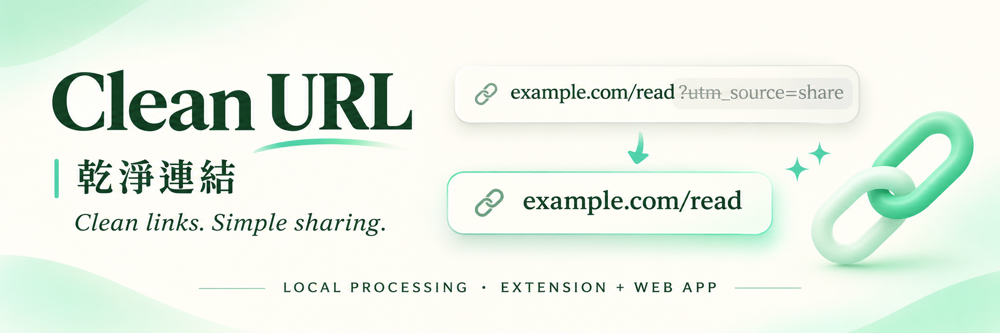

# Clean URL｜乾淨連結

**繁體中文** | [English](README.en.md)

[](https://chromewebstore.google.com/detail/clean-url%EF%BD%9C%E4%B9%BE%E6%B7%A8%E9%80%A3%E7%B5%90/ecfnblelamnokaknaepkjbhbckmakkka)
[](https://github.com/bruce-yang-422/clean-url-extension/releases)
[](https://cleanlink.stack-base.com/)


[](LICENSE)

一鍵移除網址中的追蹤參數，在本機複製乾淨、簡短的連結。提供 Chrome／Edge 擴充功能與可離線使用的網頁版（PWA），兩者共用同一份清理規則。

**[安裝擴充功能](https://chromewebstore.google.com/detail/clean-url%EF%BD%9C%E4%B9%BE%E6%B7%A8%E9%80%A3%E7%B5%90/ecfnblelamnokaknaepkjbhbckmakkka)** ·
**[網頁版](https://cleanlink.stack-base.com/)** ·
**[下載](https://github.com/bruce-yang-422/clean-url-extension/releases)** ·
**[隱私權政策](https://cleanlink.stack-base.com/privacy.html)**

```text
https://shopee.tw/商品名稱-i.123.456?sp_atk=…&utm_source=line   →   https://shopee.tw/product/123/456
https://youtu.be/abcdefghijk?si=AbCdEf&t=42                       →   https://youtu.be/abcdefghijk?t=42
https://example.com/article?utm_source=x#intro:~:text=hello       →   https://example.com/article#intro
```

## 目錄

- [功能特色](#功能特色)
- [安裝](#安裝)
- [使用方式](#使用方式)
- [清理規則](#清理規則)
- [權限與隱私](#權限與隱私)
- [開發](#開發)
- [專案結構](#專案結構)
- [授權](#授權)

## 功能特色

- **通用追蹤清理**：移除 UTM、廣告點擊 ID、電子報與行銷自動化參數，以及 `#:~:text=` 文字醒目標示片段。
- **網站專屬規則**：針對台灣常見電商與主流社群平台整理網址，例如把蝦皮、酷澎、Amazon 商品網址縮短為商品入口。
- **不把連結清壞**：保留搜尋條件、商品編號、未知參數與錨點；含雲端儲存簽章的連結整條保留。
- **右鍵選單**：在網頁或任一連結上按右鍵即可複製乾淨網址，不必開啟彈窗。
- **可編輯結果**：彈窗中的乾淨連結可先修改再複製。
- **7 種介面語言**：繁體中文、簡體中文、英文、日文、韓文、西班牙文、法文，依瀏覽器語言自動切換。
- **網頁版／PWA**：可安裝、可離線使用，Android 可從其他 App 的分享選單直接傳入網址。
- **完全本機處理**：不設伺服器、不收集資料、不保存瀏覽紀錄，無第三方相依套件。

## 安裝

### Chrome 線上應用程式商店（建議）

1. 開啟 [Clean URL｜乾淨連結商店頁面](https://chromewebstore.google.com/detail/clean-url%EF%BD%9C%E4%B9%BE%E6%B7%A8%E9%80%A3%E7%B5%90/ecfnblelamnokaknaepkjbhbckmakkka)，點選「加到 Chrome」。
2. Edge 使用者可開啟同一頁面，依提示允許來自其他商店的擴充功能後安裝。

### 手動安裝

1. 從 [Releases](https://github.com/bruce-yang-422/clean-url-extension/releases) 下載 `clean-url-extension-v版本.zip` 並解壓縮。
2. 開啟 `chrome://extensions`（Edge 為 `edge://extensions`），啟用「開發人員模式」。
3. 選擇「載入未封裝項目」，選取解壓後的資料夾（內含 `manifest.json`）。

### 網頁版

開啟 [cleanlink.stack-base.com](https://cleanlink.stack-base.com/) 即可使用，也可從瀏覽器選單「安裝應用程式」或「加入主畫面」。第一次連線完成離線準備後，就能離線清理。

## 使用方式

| 方式 | 操作 |
| --- | --- |
| 工具列彈窗 | 點選工具列的 Clean URL 圖示，確認或編輯乾淨連結後按「複製乾淨連結」。 |
| 右鍵選單（頁面） | 在網頁上按右鍵 →「複製此頁的乾淨連結」。完成時圖示短暫顯示 ✓。 |
| 右鍵選單（連結） | 在任一連結上按右鍵 →「複製連結的乾淨網址」，不必先點開連結。 |
| 網頁版 | 貼上網址，按「複製乾淨連結」。 |
| 分享選單（Android） | 安裝 PWA 後，在其他 App 的分享選單選取 Clean URL。 |

介面語言跟隨 Chrome 的顯示語言（`chrome://settings/languages`），更改後重新啟動 Chrome 即可。iPhone／iPad 的 PWA 不支援分享接收，請改用貼上網址。

## 清理規則

### 通用規則

套用於所有網站。參數名稱不分大小寫，名單參考 [AdGuard URL Tracking filter](https://github.com/AdguardTeam/AdguardFilters/tree/master/TrackParamFilter)。

| 類別 | 參數 |
| --- | --- |
| UTM | `utm_*` |
| 廣告點擊 ID | `gclid` `gbraid` `wbraid` `dclid` `gclsrc` `gad_source` `gad_campaignid` `fbclid` `msclkid` `ttclid` `twclid` `igshid` `yclid` `ysclid` `li_fat_id` `epik` `irclickid` 等 |
| 購物來源 | `srsltid`（Google 購物） |
| 分析 | `_ga` `_gl` `mtm_*` `pk_*` `piwik_*` `s_cid` `xtor` `at_*` `wt_mc` |
| 電子報與行銷自動化 | `mc_cid` `mc_eid` `mc_tc` `mkt_tok` `_hsenc` `_hsmi` `__hs*` `hsa_*` `elq*` `_kx` `vero_*` `oly_*` `ml_subscriber*` `bsft_*` |
| 聯盟行銷與 App 歸因 | `cjevent` `sscid` `tduid` `_branch_*` `adjust_*` `adj_*` |
| 文字片段 | `#:~:text=…`（保留前方的一般錨點） |

### 網站專屬規則

只在指定網域套用，帶帳密或非標準連接埠的網址不套用。

| 網站 | 規則 |
| --- | --- |
| 蝦皮 | 商品網址縮短為 `/product/賣場ID/商品ID`，分類縮短為 `c-cat.分類ID`；移除 `sp_atk` `xptdk` `publish_id` `uls_trackid` `incoming_source`、圖片選取 `image_ids` 與規格預選 `extraParams`；從商品頁進入賣場的 `entryPoint=ShopByPDP` 脈絡也會移除。 |
| momo | 商品頁移除廣告導流與搜尋入口版位（`osm` `mdiv` `Area` `oid` `cid` `kw` 等已知格式）；活動頁保留 `lpn`；品牌搜尋條件保留。 |
| PChome 24h | 商品頁 `/prod/…` 移除全部查詢參數（優先於簽章保護）。 |
| 酷澎 | 商品網址縮短為 `/products/商品ID`，移除規格、賣家與搜尋歸因參數。 |
| 博客來／樂天／Yahoo 購物 | `loc` `sloc`／`l-id` `s-id` `scid`／`co_servername` |
| Amazon | 商品網址縮短為 `/dp/商品編號`，移除 `ref` `pd_rd_*` `pf_rd_*` `tag` 等，保留 `th` `psc` 規格。 |
| AliExpress／淘寶／天貓 | `spm` `scm` `pvid` `algo_pvid` `aff_*` `ali_trackid` 等 |
| Google 搜尋 | 移除 `ved` `ei` `sca_esv` `oq` `gs_lp` 等，保留 `q` `tbm`。 |
| Facebook | `mibextid` `rdid` `__cft__` `__tn__` `eav` `paipv` |
| Instagram／Threads | `igsh` 等；Threads 貼文另移除 `xmt` `slof`。 |
| X（Twitter） | `s` `ref_src`；貼文頁另移除 `t`。 |
| YouTube／Spotify | `si` `pp` `feature`；保留時間點 `t` 與播放清單 `list`。 |
| TikTok／Reddit／LinkedIn／Bilibili | `_r` `_t` `is_from_webapp`／`share_id`／`trk*`／`spm_id_from` `vd_source` 等 |

PTT、Dcard 等其他網站適用通用規則。

### 保留與限制

- 保留剩餘參數的原始順序、重複值與編碼，不重新序列化整段網址；已乾淨的網址維持原樣。
- 偵測到 `X-Amz-Signature`、`X-Goog-Signature`、`Signature` 或 `sig` 時保留整條連結（PChome 商品頁例外）。這不是完整的簽章格式辨識器。
- 僅支援 HTTP／HTTPS。不展開短網址、不追蹤轉址、不清理巢狀連結，也不改動目前分頁。

## 權限與隱私

| 權限 | 用途 |
| --- | --- |
| `activeTab` | 開啟彈窗時讀取目前分頁網址。 |
| `clipboardWrite` | 按下複製時寫入剪貼簿；不讀取剪貼簿內容。 |
| `contextMenus` | 提供右鍵選單；只在點選時讀取該頁面或連結的網址。 |
| `offscreen` | 右鍵選單複製時，由不可見的內部頁面寫入剪貼簿。 |

安裝時不會出現額外的權限警告。沒有內容注入、全站存取、分析追蹤，也不儲存任何網址或瀏覽紀錄。詳見 [隱私權政策](https://cleanlink.stack-base.com/privacy.html)。

## 開發

需要 Node.js 22 以上，沒有第三方相依套件，原始碼即執行檔，不需建置步驟。

| 指令 | 說明 |
| --- | --- |
| `npm test` | 執行單元與網站矩陣測試。 |
| `npm run check` | 語法檢查。 |
| `npm run package` | 測試後產生 `unpacked/` 與 `Release/clean-url-extension-v版本.zip`，並移除舊版 ZIP；不會推送或發布。 |
| `npm run build:web` | 產生網站靜態檔 `web-dist/`。 |
| `npm run test:web` | 以真實瀏覽器測試網頁版（需先建置）。 |

```powershell
npm test
npm run package

# 網頁版瀏覽器測試
npm run build:web
$env:BROWSER_PATH = 'C:\Program Files\Google\Chrome\Application\chrome.exe'
npm run test:web                             # GitHub Pages 子路徑
$env:WEB_BASE_PATH = '/'; npm run test:web   # 自訂網域根路徑
```

擴充功能的真實瀏覽器測試 `scripts/browser-check.mjs` 需要支援 `--load-extension` 的 Chromium 測試版本；一般版 Chrome 137 起已不支援。

```powershell
$env:BROWSER_PATH = 'C:\path\to\chromium\chrome.exe'
$env:EXTENSION_PATH = (Resolve-Path unpacked).Path
node scripts/browser-check.mjs
```

### 測試範圍

- 核心測試：中文與原始編碼、重複與空值參數、長網址、片段、簽章與不支援的協定。
- 網站矩陣 `tests/fixtures/site-matrix.json`：28 個網站／服務與 3 類通用規則，共 68 種情境；每種情境同時驗證預期結果、通用參數清理、簽章保護與重複清理穩定性。
- 多語系：7 種語言的介面文字與 `_locales` 完整性。
- PWA：Service Worker 快取範圍、離線載入與分享接收。

### 部署網頁版

GitHub Pages 從 `main` 分支根目錄發布（Settings → Pages → Deploy from a branch → `main`／`(root)`），`.nojekyll` 讓檔案直接作為靜態網站提供。自訂網域 `cleanlink.stack-base.com` 以 DNS CNAME 指向 `bruce-yang-422.github.io` 並啟用 HTTPS。所有資源使用相對路徑，也支援 GitHub Pages 專案子路徑。離線與安裝功能需要 HTTPS 或 localhost。

## 專案結構

```text
├── url-cleaner.js                 清理核心（擴充功能與網頁版共用）
├── manifest.json                  擴充功能設定
├── popup.html / .css / .js        擴充功能彈窗
├── background.js                  右鍵選單
├── offscreen.html / .js           右鍵選單的剪貼簿寫入
├── i18n.js, _locales/             7 種語言介面文字
├── index.html, web.css, web.js    網頁版
├── manifest.webmanifest, sw.js    PWA 設定與離線快取
├── share-target.js                分享接收解析
├── privacy.html                   隱私權政策
├── icons/                         圖示（原稿 clean-url.ico）
├── scripts/                       打包、建置與瀏覽器測試
└── tests/                         自動化測試
```

## 授權

本專案採用 [MIT 授權條款](LICENSE)。您可以自由使用、修改與散布，惟須保留原始的著作權聲明與授權條款。
